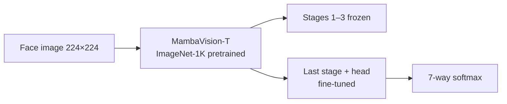

# MambaVision for Facial Emotion Recognition

> Fine-tuning NVIDIA's hybrid **Mamba–Transformer** vision backbone (**MambaVision-T**) for 7-class facial expression recognition, benchmarked against a CNN baseline (**EfficientNet-B2**), with an additional pure-SSM **Vision Mamba (Vim)** pipeline.

   

## Results (7 classes · 21,760 images · 80/10/10 split)

| Model | Backbone type | Params trained | Test accuracy | Macro F1 |
|---|---|---|---|---|
| **MambaVision-T-1K** (fine-tuned) | Hybrid Mamba + self-attention | 18.8M / 31.8M (59%) | **81.71%** | **0.787** |
| EfficientNet-B2 (last 3 blocks unfrozen) | CNN | — | 86.86% (best val) | — |

Per-class results for MambaVision (test set):

| Class | Precision | Recall | F1 |
|---|---|---|---|
| Angry | 0.744 | 0.773 | 0.759 |
| Disgust | 0.868 | 0.993 | 0.926 |
| Fear | 0.938 | 0.539 | 0.684 |
| Happy | 0.909 | 0.924 | 0.916 |
| Neutral | 0.681 | 0.801 | 0.736 |
| Sad | 0.793 | 0.625 | 0.699 |
| Surprise | 0.848 | 0.736 | 0.788 |

**Findings**
- On this mid-sized dataset (~17K training images), a well-tuned CNN (EfficientNet-B2) outperformed MambaVision-T by ~5 points; MambaVision's global token mixing did not compensate for less inductive bias at this scale.
- MambaVision is strong on visually distinctive classes (*Happy*, *Disgust*) but has low recall on *Fear* (0.54) and *Sad* (0.63), which are commonly confused with *Surprise* and *Neutral*.

## Data

A unified dataset combining:
- [Emotion Recognition Dataset](https://www.kaggle.com/) — Angry, Happy, Neutral, Sad, Surprise
- [AffectNet](http://mohammadmahoor.com/affectnet/) — Fear and Disgust (Disgust oversampled to balance classes)

Images resized to 224×224 with ImageNet normalisation; augmentation: random resized crop, horizontal flip, rotation, colour jitter, affine.

## Approach



- Load `nvidia/MambaVision-T-1K` via Hugging Face (`trust_remote_code=True`), replace the classifier head with a 7-class head.
- Freeze early stages, fine-tune the last stage and head (59% of parameters).
- Cross-entropy loss, Adam, 25+ epochs with checkpointing; evaluate with accuracy, macro F1, per-class report and confusion matrix.

## Repository structure

```
mambavision-facial-emotion-recognition/
├── notebooks/
│   ├── 01_mambavision_finetune.ipynb                    # ⭐ MambaVision-T fine-tuning + evaluation
│   └── 02_efficientnet_b2_baseline_vs_mambavision.ipynb # CNN baseline + comparison plots
├── src/
│   └── vision_mamba_vim_fer2013.py                      # Vision Mamba (Vim) fine-tuning on FER2013 (experimental)
└── requirements.txt
```

## Getting started

Developed on **Kaggle GPU**. `mamba-ssm` requires an NVIDIA GPU with CUDA.

```bash
pip install -r requirements.txt
```

Attach the datasets above to the notebook, update the dataset paths in the data-loading cell, and run all cells.

## References

- A. Hatamizadeh & J. Kautz, *MambaVision: A Hybrid Mamba-Transformer Vision Backbone*, CVPR 2025 — [arXiv:2407.08083](https://arxiv.org/abs/2407.08083) · [model](https://huggingface.co/nvidia/MambaVision-T-1K)
- A. Gu & T. Dao, *Mamba: Linear-Time Sequence Modeling with Selective State Spaces*, 2023 — [arXiv:2312.00752](https://arxiv.org/abs/2312.00752)
- L. Zhu et al., *Vision Mamba: Efficient Visual Representation Learning with Bidirectional State Space Model*, ICML 2024 — [arXiv:2401.09417](https://arxiv.org/abs/2401.09417)
- M. Tan & Q. Le, *EfficientNet*, ICML 2019 — [arXiv:1905.11946](https://arxiv.org/abs/1905.11946)
- A. Mollahosseini et al., *AffectNet*, IEEE TAC 2017 — [arXiv:1708.03985](https://arxiv.org/abs/1708.03985)

## Author

**Jatothu Arun** — [@Arun7113](https://github.com/Arun7113)

> Note: notebook image outputs (dataset faces) have been removed for privacy and dataset-licence reasons. The summary printout in notebook 02 that reads "MambaVision wins by +8143%" is a units bug (it compares 0.8686 to 82.31 as a percentage); the correct comparison is the table above.
